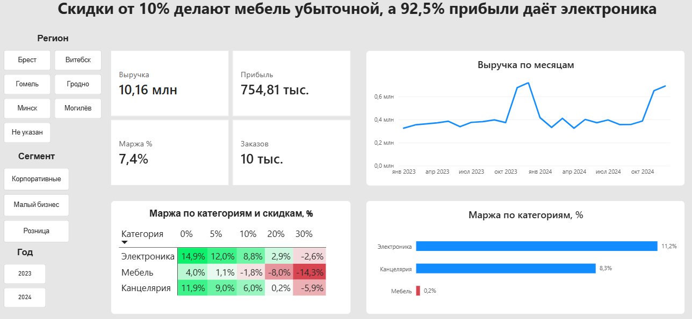

# Анализ маржинальности: какие категории и скидки приносят прибыль

**Вопрос:** какие категории и уровни скидок приносят прибыль, а какие её съедают?

## Данные

Синтетические данные: 10 000 заказов за 2023-2024 годы, 3 категории товаров, 6 регионов Беларуси, 3 сегмента клиентов. Данные генерирует скрипт `gen_data.py`.
Заложено три закономерности: сезонность (в ноябре-декабре заказов вдвое больше), разная базовая маржа по категориям и снижение маржи при росте скидки. Количество товаров в заказе от скидки не зависит. Для практики очистки добавлены пропуски и дубликаты.

## Как воспроизвести

```
pip install -r requirements.txt
python gen_data.py
python check.py
```

SQL-запросы для дашборда лежат в `queries.sql` (PostgreSQL). Дашборд собран в Power BI на данных из таблицы `orders`.



## Что сделано

1. **Генерация данных** (`gen_data.py`): pandas, numpy, воспроизводимость через seed.
2. **Проверка качества** (`check.py`): найдено 202 пропуска в регионе и 50 полных дубликатов. Дубликаты удалены, пропуски помечены значением «Не указан» (строки не удалял, чтобы не терять выручку).
3. **Анализ в Python:** маржа по категориям и скидкам, сводная матрица «категория × скидка».
4. **SQL** (`queries.sql`): агрегации, оконные функции (доли, прирост к предыдущему месяцу, лучший клиент в категории).
5. **Дашборд в Power BI:** показатели, динамика по месяцам, маржа по категориям, тепловая карта «категория × скидка», фильтры по региону, сегменту и году.

## Ключевые показатели

| Показатель | Значение |
|---|---|
| Выручка | 10 160 003 |
| Прибыль | 754 805 |
| Маржа | 7,4% |
| Заказов | 10 000 |

## Маржа по категориям и скидкам, %

| Категория | 0% | 5% | 10% | 20% | 30% |
|---|---|---|---|---|---|
| Электроника | 14,9 | 12,0 | 8,8 | 2,9 | -2,6 |
| Канцелярия | 11,9 | 9,0 | 6,0 | 0,2 | -5,9 |
| Мебель | 4,0 | 1,1 | -1,8 | -8,0 | -14,3 |

## Выводы

1. **Электроника** даёт 61,6% выручки и 92,5% прибыли (маржа 11,2%). **Мебель** даёт 32,4% выручки, но 0,8% прибыли (маржа 0,2%).
2. Скидки снижают маржу в каждой категории. **Порог безубыточности:** мебель около 6-7%, канцелярия около 20%, электроника около 25%.
3. На заказах со скидкой 20% и 30% суммарный убыток около 52 тыс. при обороте 1,7 млн.
4. Среднее количество товаров в заказе не растёт вместе со скидкой, поэтому в этих данных скидки не стимулируют объём и только снижают маржу.

## Рекомендации

- Ввести лимиты скидок по категориям: мебель до 5%, электроника и канцелярия до 10%.
- Проверить закупочные цены на мебель: даже без скидок её маржа всего 4%.

## Ограничения

- Данные синтетические. Связь «скидка → количество» не закладывалась, поэтому вывод 4 касается только этого набора. На реальных данных нужно проверять, окупает ли скидка рост продаж.
- Маржа считается как прибыль к выручке без учёта аренды, логистики и зарплат, так что реальная картина хуже.
- Доля клиентов с повторной покупкой (87,4%) завышена из-за случайной генерации клиентов и не отражает реальное поведение.

## Структура репозитория

- `gen_data.py` генерация данных
- `check.py` очистка и анализ
- `queries.sql` SQL-запросы для дашборда
- `sales_dashboard.pbix` дашборд Power BI
- `dashboard.png` скриншот дашборда
- `requirements.txt` зависимости
